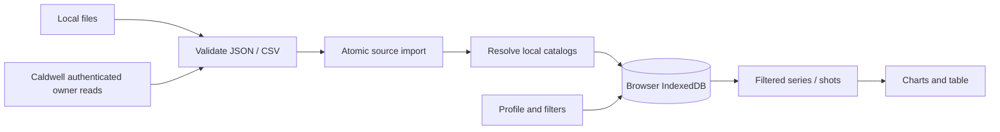

# Architecture

The owner approved a local-first MVP on 2026-10-18; see [decision 001](docs/decisions/001-local-first-mvp.md). The feasibility project is not reused.

## Runtime and ownership

React/TypeScript compile through Vite to static assets. Dexie manages IndexedDB and ECharts renders recorded measurements. The PWA precaches build assets only. GitHub Pages is a static host, with no backend or user-data storage.

Every measurement and user setting belongs to the local browser, never the source tree, build or host. Storage is origin/profile-specific. No telemetry, external font requests or runtime CDN exists. Optional Caldwell sources authenticate directly with Firebase; the service receives credentials for its own account, with no VelociTrack intermediary.

## Import and identity

File reads and cloud downloads finish before an IndexedDB transaction. One transaction resolves catalog references, upserts the source's series/shots and marks success. Any failure rolls it back. Failure status is saved separately while retaining last success. Refresh spans all enabled sources independently of filters; file sources ask for current files and Caldwell sources use their available sessions. One tab deduplicates concurrent refreshes per source. Downloads are paginated with record/byte limits; failures never commit a truncated result.

| Entity | Responsibility |
| --- | --- |
| DataSource | Local name, adapter, enabled flag, catalog policy and refresh status |
| Series | Source-scoped identity, date, name, catalog links, raw record |
| Shot | Series-scoped identity, measured values, raw unit code, exclusion, raw record |
| CatalogItem | Shared firearm/projectile name, source links and naming provenance |
| Annotation | Separate local notes and typed fields, protected from refresh |
| Profile | Local singleton nickname, preferences and filters |

Composite IDs encode tuples as JSON. Provider IDs are always source-scoped. Reimport updates existing identities and retains records absent from subsequent files: cumulative upserts, not inferred deletions. Before upserts, the same write transaction checks incoming identities and counts only previously absent series/shots. Counts are returned after the transaction succeeds. Batch refresh reports the sum across successful sources and flags sources still needing attention; an unchanged last source cannot hide earlier new records.

Catalog resolution uses `(sourceId, remoteId)` first. A unique unlinked manual name can satisfy a new reference. Otherwise the source policy either creates it or fails with the missing name. Different sources are not merged by name. Automatic updates may rename source-managed entries; manual edits remove source-managed naming ownership. Source removal atomically deletes its measurements/annotations and catalog links, clears its saved source filter and retains catalog names.

Raw records stay local and unchanged in the supported adapters' ft/s, ft and °F input units, confirmed by the owner in decision 006. `domain/units.ts` converts only presentation values: metric length/speed multiply by exactly 0.3048; temperature uses `(F - 32) × 5/9`. Summary mean, SD and spread use the velocity factor. Charts, point details, table readings, navigation and unit labels use the profile preference. G1/G7 are unchanged coefficients. Source unit enum codes remain metadata; existing source/code comparison grouping stays in place. Views omit paired zero padding and invalid points while reporting counts; arrays keep original order/length. Other atmosphere semantics are not inferred.

Series custom-field definitions support short text, note, number, weight, speed and distance. Annotation values are keyed by stable field ID; optional tagIds refer to reusable named/color tags. Legacy fields/notes remain preserved. Dimensional values use canonical gr, ft/s and ft; editor/display conversion follows profile units. Only edited fields are written. Definitions, tag changes and removal cleanup use transactions. See decision 007.

## UI and persistence

Dexie live queries expose changes to React. Filters combine OR within a list and AND across lists; manual ranges include entire local dates. Relative dates stay relative. Comparison selection is transient. Table shot deselection exceptions are held in page memory, so new identities start selected and filtering/refresh never reset existing choices. Selected shots feed charts and summaries; the table shows all shots in selected series, including unchecked rows. Shared hover/focus uses stable shot IDs; ECharts emphasis actions avoid rebuilding the chart on hover. Point metadata retains original sample indexes after padding removal. Tooltip content is escaped React text, independent of canvas emphasis, with a ten-pixel hit tolerance around actual samples. Native dialogs contain focus and support Escape; charts have a table alternative.

Per-source import jobs publish a stable external-store snapshot for centered progress. Both file and cloud imports clear it on success/failure. A toolbar batch keeps its progress dialog alive between sources and opens action-required source controls only after completion. Dismissing progress does not cancel work. Each notification object owns a ten-second timer, including identical repeated messages; unmount/replacement cancels the previous timer. See decision 004.

Desktop places series beside analysis; mobile places a horizontal series selector above it. The local profile chooses Imperial/Metric units, the active analysis, independent chart axes/quantities, ordered table columns, projectile mass labels and Light/Dark/Auto theme. The legacy shot-detail setting is retained for old archives but no longer exposed; the chart's primary scalar determines emphasis of corresponding standard table readings. Missing fields in older profiles receive defaults on read without resetting existing preferences or measurements. Display choices persist; transient shot selection is unaffected. Chart views offer horizontal and vertical sliders with explicit axis binding and `filterMode: none`; zoom changes only the visible range, never shot selection or statistical membership. Moving either slider clears stale point details. Use system fonts, visible focus, reduced motion and local branding assets.

Schema version 2 adds fieldDefinitions, tags, attachments and attachmentContents to the original sources, catalog, series, shots, profiles and annotations. This additive migration never clears old data. Attachment bytes are Blob records and are omitted from ordinary live-query snapshots. Backup captures all tables in a consistent read transaction; validated ZIP restore replaces all tables atomically. Quota errors roll back writes. Archive limits, authentication cleanup, import/restore Web Locks and restoration semantics are specified in decision 007. Clearing browser data or eviction can remove content; retain original exports.

Production service-worker updates ask for a reload. Each tab reloads only after its own explicit request. Reload activates the currently waiting worker and waits for activation or a controller change; a stale prompt reloads normally when another tab has already activated the update. A bounded wait reports failures and allows retry. This flow does not clear IndexedDB or browser storage. Only compiled assets are cached; no runtime request cache exists. First use needs a successful asset cache online or via a local server. Local content is not separately encrypted by the application.

## Extension boundaries

Add adapters behind the validated import contract. Caldwell uses the modular Firebase Auth SDK and Firestore Lite. The account UID comes only from SDK authentication; source binding and a final pre-commit check prevent mixing accounts. Each source retains its connection settings and account binding. Automatic setup reuses shared technical settings from the local profile, or an unambiguous existing source. A fresh browser loads `sources/caldwell.json` from the same origin, with credentials omitted, redirects rejected, a bounded response and a timeout. This standard source-type file contains only the shared project ID/client key, intentionally public under decision 005. Local and hosted builds use the same file; no helper/backend or deployment secret is involved. Existing configured sources are never retargeted. Source types remain fixed after creation; these optional fields need no schema/index migration.

Authentication defaults to memory. SDK persistence requires explicit profile opt-in; disabling it migrates sessions back to memory, and sign-out/removal clears the session. The application never stores passwords. Firestore uses no persistent cache or subscription; only the validated atomic import writes measurements to Dexie. Errors shown/saved by the connector use safe categories rather than raw provider responses. Catalog validation errors may include the local missing name.

The private browser-only PoC passed on loopback before integration. Full application import and repeat refresh also passed locally. The owner approved publication after review of the available terms and confirmed successful import on the published `0.2.1` Pages app on 2026-10-18. This verifies the reported hosted workflow, not provider endorsement, unrestricted access or server rule isolation. See decisions 002 and 005, `docs/VERIFICATION.md` and `docs/TERMS_REVIEW.md`. Never add a credential proxy or bypass service controls.

Introduce mapping and further tools/charts/reports as small modules when their first workflow is agreed. A generic plugin framework is unnecessary for this MVP.

## Analysis modes and display — v0.5

`domain/analysis.ts` declares scalar readers with explicit display-unit labels. Provider string context and numeric local fields are inherited onto shots; technical IDs/enums are not quantities. Missing scalars remain null and break chart lines. Simple/Dual combine selected strings in deterministic string-start/shot order, with shared X positions; Compare keeps each string's numbering. The distance comparison averages linear interpolants within each shot's measured domain, using difference arrays on a bounded observed-distance grid. It never extrapolates and does not assign an aggregate to one shot. Selected exclusions and the source/unit compatibility guard remain in force. See decision 008.

Profile additions are optional and default on read, without a schema bump. Chart edits merge inside a profile transaction; column IDs/order are saved independently. Legacy visibleFieldIds/showTags seed the first ordered-column configuration. Field removal cleans ordered columns and chart references atomically. ZIP validation accepts old profiles and validates the new nested preferences. Auto theme follows matchMedia and updates both CSS variables and ECharts colors. Full-workspace string-ID ordering assigns contrasting palette entries, symbols and dashes independently of the active selection.

Development and preview share loopback port 4180 with strictPort. Authentication remains opt-in; cached SDK handles reconcile the saved persistence preference before reuse, including preferences changed in another tab. Runtime sessions and measurements are never shared with another origin to work around browser storage isolation.
