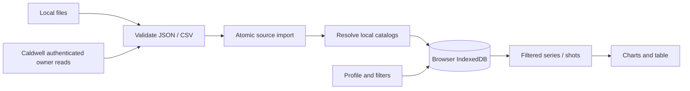

# Architecture

The owner approved a local-first MVP on 2026-10-18; see [decision 001](docs/decisions/001-local-first-mvp.md). The feasibility project is not reused.

## Runtime and ownership

React/TypeScript compile through Vite to static assets. Dexie manages IndexedDB and ECharts renders recorded measurements. The PWA precaches build assets only. GitHub Pages is a static host, with no backend or user-data storage.

Every measurement and user setting belongs to the local browser, never the source tree, build or host. Storage is origin/profile-specific. No telemetry, external font requests or runtime CDN exists. Optional Caldwell sources authenticate directly with Firebase; the service receives credentials for its own account, with no VelociTrack intermediary.

## Import and identity

File reads and cloud downloads finish before an IndexedDB transaction. One transaction resolves catalog references, upserts the source's series/shots and marks success. Any failure rolls it back. Failure status is saved separately while retaining last success. Refresh spans all enabled sources independently of filters; file sources ask for current files and Caldwell sources use their available sessions. One tab deduplicates concurrent refreshes per source. Downloads are paginated with record/byte limits; failures never commit a truncated result.

| Entity | Responsibility |
| --- | --- |
| DataSource | Local name, adapter, enabled flag, catalog policy and refresh status |
| Series | Source-scoped identity, date, name, catalog links, raw record |
| Shot | Series-scoped identity, measured values, raw unit code, exclusion, raw record |
| CatalogItem | Shared firearm/projectile name, source links and naming provenance |
| Annotation | Separate local notes and typed fields, protected from refresh |
| Profile | Local singleton nickname, preferences and filters |

Composite IDs encode tuples as JSON. Provider IDs are always source-scoped. Reimport updates existing identities and retains records absent from subsequent files: cumulative upserts, not inferred deletions.

Catalog resolution uses `(sourceId, remoteId)` first. A unique unlinked manual name can satisfy a new reference. Otherwise the source policy either creates it or fails with the missing name. Different sources are not merged by name. Automatic updates may rename source-managed entries; manual edits remove source-managed naming ownership. Source removal atomically deletes its measurements/annotations and catalog links, clears its saved source filter and retains catalog names.

Raw records stay local. No units or atmosphere are invented. Views omit paired zero padding and invalid points while reporting counts; arrays keep original order/length. Combined charts/statistics require one source/raw-unit group, a provisional assumption rather than physical-unit validation.

Typed custom values have text, number, boolean, date and choice variants. Annotation storage is ready for future editing without refresh overwrites. Field definitions, applicability, validation/migrations and editing UI remain later work.

## UI and persistence

Dexie live queries expose changes to React. Filters combine OR within a list and AND across lists; manual ranges include entire local dates. Relative dates stay relative. Comparison selection is transient. Native dialogs contain focus and support Escape; charts have a table alternative and canvas-text tooltips rather than imported HTML.

Desktop places series beside analysis; mobile places a horizontal series selector above it. Use system fonts, visible focus, reduced motion and local branding assets.

Schema version 1 includes sources, catalog, series, shots, profiles and annotations. Add explicit migrations when changing schemas; never reset user data for convenience. Backup/restore and quota handling are follow-up work. Clearing browser data or eviction can remove content; retain original exports.

Production service-worker updates ask for a reload. Each tab reloads only after its own explicit request. Reload activates the currently waiting worker and waits for activation or a controller change; a stale prompt reloads normally when another tab has already activated the update. A bounded wait reports failures and allows retry. This flow does not clear IndexedDB or browser storage. Only compiled assets are cached; no runtime request cache exists. First use needs a successful asset cache online or via a local server. Local content is not separately encrypted by the application.

## Extension boundaries

Add adapters behind the validated import contract. Caldwell uses the modular Firebase Auth SDK and Firestore Lite. The account UID comes only from SDK authentication; source binding and a final pre-commit check prevent mixing accounts. The source owns locally imported connection settings and a local account binding. No provider configuration is bundled. Source types remain fixed after creation; existing file-source rows require no schema reset or index migration.

Authentication defaults to memory. SDK persistence requires explicit profile opt-in; disabling it migrates sessions back to memory, and sign-out/removal clears the session. The application never stores passwords. Firestore uses no persistent cache or subscription; only the validated atomic import writes measurements to Dexie. Errors shown/saved by the connector use safe categories rather than raw provider responses. Catalog validation errors may include the local missing name.

The private browser-only PoC passed on loopback before integration. Full application import and repeat refresh also passed locally. The owner approved publication after review of the available terms; hosted-origin support and provider permission remain unconfirmed. See decision 002, `docs/FIREBASE_POC.md` and `docs/TERMS_REVIEW.md`. Never add a credential proxy or bypass service controls.

Introduce mapping, custom fields, tools/charts/reports as small modules when their first workflow is agreed. A generic plugin framework is unnecessary for this MVP.
