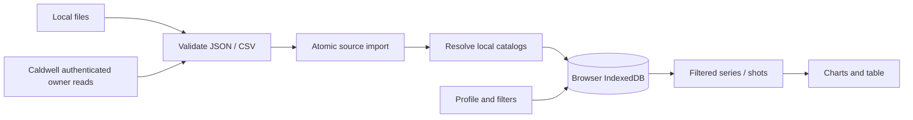

# Architecture

Release 0.23.0 adds an opt-in static demo package and a separate visual-guide entry.
`sources/demo.ts` validates and remaps the curated sample before an atomic all-table
installation. Definition namespaces track ownership through backup/restore and
support removal choices without deleting reused fields/tags. User preferences are
preserved. Refresh leaves the fixed sample unchanged. Backup data version 4 adds
the demo source kind and optional invitation-dismissal flag; versions 1–3 remain
readable. No IndexedDB schema change is needed.

`help/index.html` and `src/help/` build an independent guide with no storage/auth
access. The app's help icon opens it. Demo assets and walkthrough PNGs are excluded
from precaching and requested only as needed. The public sample and reviewed
captures are the sole owner-authorized exception to private measurement assets;
all normal imports, preferences and demo edits remain local. See
[decision 030](docs/decisions/030-public-demo-and-visual-guide.md),
[demo review](docs/DEMO_DATA.md) and [help authoring](docs/HELP_AUTHORING.md).

Release 0.22.0 adds local Report Builder templates and a remembered Tools selection.
The shared `charts/options.ts` and `charts/engine.ts` render screen and PDF charts.
`reports/builder.ts` plans ordered combined/per-string views; `renderBuilder.ts`
renders them sequentially without changing screen state. Templates reuse current
selection, units, paper and table columns. Backup data version 3 includes templates;
older readers migrate forward without resetting IndexedDB. See
[decision 029](docs/decisions/029-report-builder.md).

Release 0.21.0 versions backup envelopes and data independently of the application
and IndexedDB. Checksums precede in-memory migrations; strict current validation
precedes the compatibility preview and atomic replacement. Version-one readers
remain supported. See [backup contract](docs/BACKUP_FORMAT.md) and
[decision 028](docs/decisions/028-versioned-backups-and-overview-pages.md).
Wide report overviews use landscape with each comparison group on its own page.

Release 0.20.0 adds local screen chart height and A4/Letter report paper preferences.
The chart capture uses a paper-specific aspect ratio, independently of screen size.
String comparison bars/lines and both legends share stable colors; table group
boundaries share one ID-based rule. See [decision 027](docs/decisions/027-chart-and-report-presentation.md).

The owner approved a local-first MVP on 2026-10-18; see [decision 001](docs/decisions/001-local-first-mvp.md). The feasibility project is not reused.

## Runtime and ownership

React/TypeScript compile through Vite to static assets. Dexie manages IndexedDB and ECharts renders recorded measurements. The PWA precaches build assets only. GitHub Pages is a static host, with no backend or user-data storage.

Every user's imported measurement and setting belongs to the local browser. The explicitly curated demo is a public downloadable example, separate from user workspaces. Storage is origin/profile-specific. No telemetry, external font requests or runtime CDN exists. Optional Caldwell sources authenticate directly with Firebase; the service receives credentials for its own account, with no VelociTrack intermediary.

## Import and identity

File reads and cloud downloads finish before an IndexedDB transaction. One transaction resolves catalog references, upserts the source's series/shots and marks success. Any failure rolls it back. Failure status is saved separately while retaining last success. Refresh spans all enabled sources independently of filters; file sources ask for current files and Caldwell sources use their available sessions. One tab deduplicates concurrent refreshes per source. Downloads are paginated with record/byte limits; failures never commit a truncated result.

| Entity      | Responsibility                                                                |
| ----------- | ----------------------------------------------------------------------------- |
| DataSource  | Local name, adapter, enabled flag, catalog policy and refresh status          |
| Series      | Source-scoped identity, date, name, catalog links, raw record                 |
| Shot        | Series-scoped identity, measured values, raw unit code, exclusion, raw record |
| CatalogItem | Shared firearm/projectile name, source links and naming provenance            |
| Annotation  | Separate local notes and typed fields, protected from refresh                 |
| Profile     | Local singleton nickname, preferences and filters                             |

Composite IDs encode tuples as JSON. Provider IDs are always source-scoped. Reimport updates existing identities and retains records absent from subsequent files: cumulative upserts, not inferred deletions. Before upserts, the same write transaction checks incoming identities and counts only previously absent series/shots. Counts are returned after the transaction succeeds. Batch refresh reports the sum across successful sources and flags sources still needing attention; an unchanged last source cannot hide earlier new records.

Catalog resolution uses `(sourceId, remoteId)` first. A unique unlinked manual name can satisfy a new reference. Otherwise the source policy either creates it or fails with the missing name. Different sources are not merged by name. Automatic updates may rename source-managed entries; manual edits remove source-managed naming ownership. Source removal atomically deletes its measurements/annotations and catalog links, clears its saved source filter and retains catalog names.

Raw records stay local and unchanged in the supported adapters' ft/s, ft and °F input units, confirmed by the owner in decision 006. `domain/units.ts` converts only presentation values: metric length/speed multiply by exactly 0.3048; temperature uses `(F - 32) × 5/9`. Summary mean, SD and spread use the velocity factor. Charts, point details, table readings, navigation and unit labels use the profile preference. G1/G7 are unchanged coefficients. Source unit enum codes remain metadata; existing source/code comparison grouping stays in place. Views omit paired zero padding and invalid points while reporting counts; arrays keep original order/length. Other atmosphere semantics are not inferred.

String custom-field definitions support short text, note, number, weight, speed and distance, with optional assigned-value display in the string panel. Annotation values are keyed by stable field ID; optional tagIds refer to reusable named/color tags. Legacy fields/notes remain preserved. Dimensional values use canonical gr, ft/s and ft. Fixed weight-grams/weight-grains types override profile units for presentation; legacy weight, speed and distance follow the profile. Switching weight types preserves canonical values. Only edited values are written. Definitions, tag changes and removal cleanup use transactions. See decisions 007 and 009.

The analysis panel sorts all table rows once using actual column values and the persisted tableSort preference. Selected By shot data inherit this order, with consecutive per-string ranks in Compare. Distance aggregates retain one coverage interval per member shot for lazy contributor resolution and bidirectional mean/row emphasis. Column pointer dragging uses a body portal so overflow clipping cannot hide the floating card. See decision 009.

Shot annotations can persist an invalid flag independently of provider exclusion. Selection filters invalid identities from chart/statistical inputs; the table retains their original records, dimmed with disabled Analyze and an Undo action in a fixed rightmost column. The heading's tri-state Analyze checkbox changes all eligible rows across pages in one state update, preserving exceptions outside the current table. Invalidation merges annotations transactionally and survives reimport/backup. See decision 010.

Calculated Over distance velocities use each shot's original muzzle velocity and matching G1/G7 in an independent drag-only integrator with factual reference tables and attribution. Canonical ft/ft/s remain the boundary; integration uses SI, automatically selected per-string local atmosphere (or standard fallback), constant BC and a straight path. The saved density/sound-speed pair selects both numerical inputs and local/standard provenance; reconstructed station conditions appear below the chart and in point details. See docs/ATMOSPHERE.md and decision 019. Predicted curves are dashed and labeled, share the distance velocity scale, and retain exact shot/contributor hover identity. The persisted horizon is bounded to 1 km and each model integrates at most 100 eligible shots in table order, including Compare. No weather-unit inference, measurement replacement or BC accuracy claim is made. Numerical derivation, reference-data provenance and independent analytic validation are in docs/VELOCITY_RESEARCH.md.

## UI and persistence

Dexie live queries expose changes to React. Filters combine OR within a list and AND across lists; manual ranges include entire local dates. Relative dates stay relative. Comparison selection is transient. Table shot deselection exceptions are held in page memory, so new identities start selected and filtering/refresh never reset existing choices. Selected shots feed charts and summaries; the table shows all shots in selected series, including unchecked rows. Shared hover/focus uses stable shot IDs; ECharts emphasis actions avoid rebuilding the chart on hover. Point metadata retains original sample indexes after padding removal. Tooltip content is escaped React text, independent of canvas emphasis, with a ten-pixel hit tolerance around actual samples. Native dialogs contain focus and support Escape; charts have a table alternative.

Per-source import jobs publish a stable external-store snapshot for centered progress. Both file and cloud imports clear it on success/failure. A toolbar batch keeps its progress dialog alive between sources and opens action-required source controls only after completion. Dismissing progress does not cancel work. Each notification object owns a ten-second timer, including identical repeated messages; unmount/replacement cancels the previous timer. See decision 004.

Desktop places series beside analysis; mobile places a horizontal series selector above it. The local profile chooses Imperial/Metric units, the active analysis, independent chart axes/quantities, ordered table columns, projectile mass labels and Light/Dark/Auto theme. The legacy shot-detail setting is retained for old archives but no longer exposed; the chart's primary scalar determines emphasis of corresponding standard table readings. Missing fields in older profiles receive defaults on read without resetting existing preferences or measurements. Display choices persist; transient shot selection is unaffected. Chart views offer horizontal and vertical sliders with explicit axis binding and `filterMode: none`; zoom changes only the visible range, never shot selection or statistical membership. Moving either slider clears stale point details. Use system fonts, visible focus, reduced motion and local branding assets.

Schema version 2 adds fieldDefinitions, tags, attachments and attachmentContents to the original sources, catalog, series, shots, profiles and annotations. This additive migration never clears old data. Attachment bytes are Blob records and are omitted from ordinary live-query snapshots. Backup captures all tables in a consistent read transaction; validated ZIP restore replaces all tables atomically. Quota errors roll back writes. Archive limits, authentication cleanup, import/restore Web Locks and restoration semantics are specified in decision 007. Clearing browser data or eviction can remove content; retain original exports.

Production service-worker updates ask for a reload. Each tab reloads only after its own explicit request. Reload activates the currently waiting worker and waits for activation or a controller change; a stale prompt reloads normally when another tab has already activated the update. A bounded wait reports failures and allows retry. This flow does not clear IndexedDB or browser storage. Only compiled assets are cached; no runtime request cache exists. First use needs a successful asset cache online or via a local server. Local content is not separately encrypted by the application.

## Extension boundaries

Add adapters behind the validated import contract. Caldwell uses the modular Firebase Auth SDK and Firestore Lite. The account UID comes only from SDK authentication; source binding and a final pre-commit check prevent mixing accounts. Each source retains its connection settings and account binding. Automatic setup reuses shared technical settings from the local profile, or an unambiguous existing source. A fresh browser loads `sources/caldwell.json` from the same origin, with credentials omitted, redirects rejected, a bounded response and a timeout. This standard source-type file contains only the shared project ID/client key, intentionally public under decision 005. Local and hosted builds use the same file; no helper/backend or deployment secret is involved. Existing configured sources are never retargeted. Source types remain fixed after creation; these optional fields need no schema/index migration.

Authentication defaults to memory. SDK persistence requires explicit profile opt-in; disabling it migrates sessions back to memory, and sign-out/removal clears the session. The application never stores passwords. Firestore uses no persistent cache or subscription; only the validated atomic import writes measurements to Dexie. Errors shown/saved by the connector use safe categories rather than raw provider responses. Catalog validation errors may include the local missing name.

The private browser-only PoC passed on loopback before integration. Full application import and repeat refresh also passed locally. The owner approved publication after review of the available terms and confirmed successful import on the published `0.2.1` Pages app on 2026-10-18. This verifies the reported hosted workflow, not provider endorsement, unrestricted access or server rule isolation. See decisions 002 and 005, `docs/VERIFICATION.md` and `docs/TERMS_REVIEW.md`. Never add a credential proxy or bypass service controls.

Introduce mapping and further tools/charts/reports as small modules when their first workflow is agreed. A generic plugin framework is unnecessary for this MVP.

## Analysis modes and display — v0.5

`domain/analysis.ts` declares scalar readers with explicit display-unit labels. String context and numeric local fields are inherited onto shots; technical IDs/enums are not quantities. Missing scalars remain null and break lines. Simple/Dual share the current table order; Compare uses per-string sorted ranks (decision 009). Measured distance means interpolate only within each shot's recorded domain. Model means instead cover eligible prediction domains, with explicit extrapolation labels. Both retain contributor coverage rather than inventing a single-shot identity. Selected/local/source exclusions and the source/unit compatibility guard remain in force. See decisions 008–010.

Profile additions are optional and default on read, without a schema bump. Chart edits merge inside a profile transaction; column IDs/order are saved independently. Legacy visibleFieldIds/showTags seed the first ordered-column configuration. Field removal cleans ordered columns and chart references atomically. ZIP validation accepts old profiles and validates the new nested preferences. Auto theme follows matchMedia and updates both CSS variables and ECharts colors. Full-workspace string-ID ordering assigns contrasting palette entries, symbols and dashes independently of the active selection.

Development and preview share loopback port 4180 with strictPort. Authentication remains opt-in; cached SDK handles reconcile the saved persistence preference before reuse, including preferences changed in another tab. Runtime sessions and measurements are never shared with another origin to work around browser storage isolation.

## Chart viewport state — v0.8

`domain/chartViewport.ts` separates canonical navigable domains from visible windows. The analysis panel owns session memory keyed by horizontal-axis meaning and quantity, shared for recorded/calculated velocity. Quantity definitions expose explicit affine display transforms, so unit changes preserve physical bounds. The chart mounts one ECharts instance, updates its options and retains current windows; data growth can extend the domain without changing the view. Reset fits the active axes to available plotted values. Missing data does not establish placeholder bounds.

Public ECharts zoom state updates canonical windows. A settled horizontal right edge updates only the existing forecast preference when active; a field edit updates that edge while keeping the left and vertical bounds. Larger domains survive shorter forecast values, avoiding a feedback loop. Vertical gestures do not write the forecast field. No database schema, backup format or numerical model change is introduced. See decision 011.

## Distance curve registry — v0.9

`domain/distanceCurves` separates the renderer from concrete implementations. A compile-time ordered registry owns availability, labels, descriptions, canonical axis keys, display transforms and dispatch. Custom definitions receive frozen detached measured samples, a canonical horizon and complete shot/string records with raw metadata. Separate annotations, field definitions and assigned tag definitions accompany the source-scoped parent join. Availability, omission notices and every trace mode use the same current context; recorded Velocity remains built-in while the other quantities use registered callbacks. See decision 013 and docs/MEASUREMENT_UNITS.md for the extended contract and owner-confirmed altitude in ft, sea-level pressure in hPa and diameterUnit codes 0 = inches / 1 = mm. Both quantity menus and selected-function descriptions use the registry. `chart.ts` consumes validated generic point arrays, preserves identity and handles comparison means including null gaps and zero/negative values. Dual uses a separate Y axis for unrelated meanings. Dispatch bounds derived shot count/output size and catches calculation errors; trusted synchronous callbacks must bound their own CPU work. Saved IDs and the existing schema/backup remain compatible. See decision 012 and DISTANCE_CURVES.md.

## Calculated quantity catalog — v0.11

G1/G7 definitions are explicit entries in `customDistanceCurves.ts`, with separate `calculatedVelocityG1.ts` and `calculatedVelocityG7.ts` modules. Both use the ordinary frozen-context/validated-output boundary. `velocityCalculation.ts` retains the existing common implementation; the old domain path is a compatibility export. The registry implicitly supplies only recorded Velocity. Stable calculated IDs, model tooltip metadata, limits and saved preferences remain compatible. Definition metadata, constants and working-variable declarations are grouped at function starts; assignments retain their original guard/loop order. See decision 014.

## Target measurements

Version 0.12.0 adds optional string `Annotation.target`: canonical-mm values, manual-override markers and original-image geometry/calibration with a local photo reference. The photo editor owns a detached draft and writes the complete result atomically on Save. Direct numeric edits merge touched fields. Image deletion removes provenance but retains numbers; imports preserve the annotation. Generic scalar analysis and readonly custom context expose the result. The optional local `Profile.showGroupSize` controls navigator display. See [target contract](docs/TARGET_MEASUREMENTS.md) and decision 015; no schema or backup-format migration is required.

## Local PDF reports (0.17)

Version 0.17.1 adds pure `targetFigure` layout/rendering in print coordinates, with
a two-tone stroke and a separate callout rail. `recordTable` fits all visible columns
on landscape pages and forbids row splitting; impossible layouts report an actionable
error. Shared `formatQuantity` formatting applies only at readonly display boundaries.
Scalar/curve unit metadata drives precision, leaving chart coordinates, input editors,
storage and backups unchanged. See decision 021 and docs/DISPLAY_FORMAT.md.

`src/reports` separates the frozen workspace contract, pure PDF composition, local image rendering and Save as handling. `AnalysisPanel` captures selected strings/shots and current table order; `MeasurementChart` copies live zoom into a separate light canvas. `ReportDialog` lazy-loads pdfmake with bundled Roboto fonts, generates a local Blob, and offers a user-initiated file picker with download fallback. External PDF resource loading is denied.

`Profile.report` defaults all five sections on when absent. `TargetMeasurement.reportCrop` stores an optional square in original-image pixels, independent of mm calibration and group geometry. Crop bounds and photo ownership are checked on save/recovery. Existing annotation and profile backup paths preserve both additions without a schema migration. Original photos remain unchanged. See [decision 020](docs/decisions/020-local-pdf-reports.md).

Version 0.17.2 groups selected strings in a shared overview and renders their targets
in a separate section. `domain/stringInformation` supplies complete string-scoped
JSON to both the workspace and `reports/stringInfo`, without connection/profile
records. String info includes every selected string and flows across portrait pages;
chart and record sections remain shared and landscape. Target callout rails follow
the H sign, with dashed diagonal departures. TargetEditor links numeric dimensions
to one scale by default; independent overrides are an explicit session-only choice.
These changes reuse existing records, report preferences and backup validation.
See decision 022.

## Reference calibration and string cards (0.18)

Optional `TargetMeasurement.calibration` stores an independent known-length segment in original-image pixels and canonical mm. `domain/targetCalibration` validates it and computes scale/ruler intervals; target editor gestures reuse the existing snapshot, cancellation and undo boundary. Save/restore require matching image frames, coherent mm/pixel scale and photo ownership. A reference can exist without group geometry. Manual edits clear its provenance, and photo deletion clears it alongside geometry/crop. Existing backup paths preserve these optional fields without migration.

`Profile.showCaldwellNotes` defaults true and controls plain-text imported notes on cards, independently of local notes. Ctrl-click replaces the session string selection with one ID; it does not persist a new preference or affect the details button. See decision 024.

## Update discovery (0.18.1)

`pwa/updates.ts` observes native registration/worker state and checks on visible-page
resume, reconnect and five-minute intervals. It coalesces requests and cleans up
listeners/timers. `UpdateNotice` now owns the footer version/check control as well
as the fixed Reload prompt. Only an explicit Reload action activates the waiting
worker or navigates. Background discovery and manual checks never touch workspace
data. See decision 025 and troubleshooting help for older tabs and stopped previews.

## String comparison and local lists (0.19)

Decision 026 adds ownership metadata to scalar quantities. Compare By shot filters
shot scalars; By string adapts one parent record without requiring shot data.
Recorded Velocity detail shares the velocity registry adapter but bypasses mean
aggregation and uses string colors. Selection identity keys reset viewport memory
and remount the chart, cancelling pending zoom writes; other updates retain it.

FieldDefinition.options stores stable option IDs/names for List fields. Annotation
values reference IDs. Dedicated list transactions rename without rewriting values,
and delete only after confirming an unchanged usage count. Metadata saves preserve
the latest options. Display and sort adapters resolve labels; numeric menus exclude
lists. Backup validation checks definitions and memberships; no schema upgrade.

reports/renderTarget.ts owns local image decoding and invokes targetFigure.ts for
both PDF and TargetPreview. Calibrated figures reserve space below the photograph
for a physical ruler. The preview has no write actions. Empty Targets sections do
not create report page breaks.
